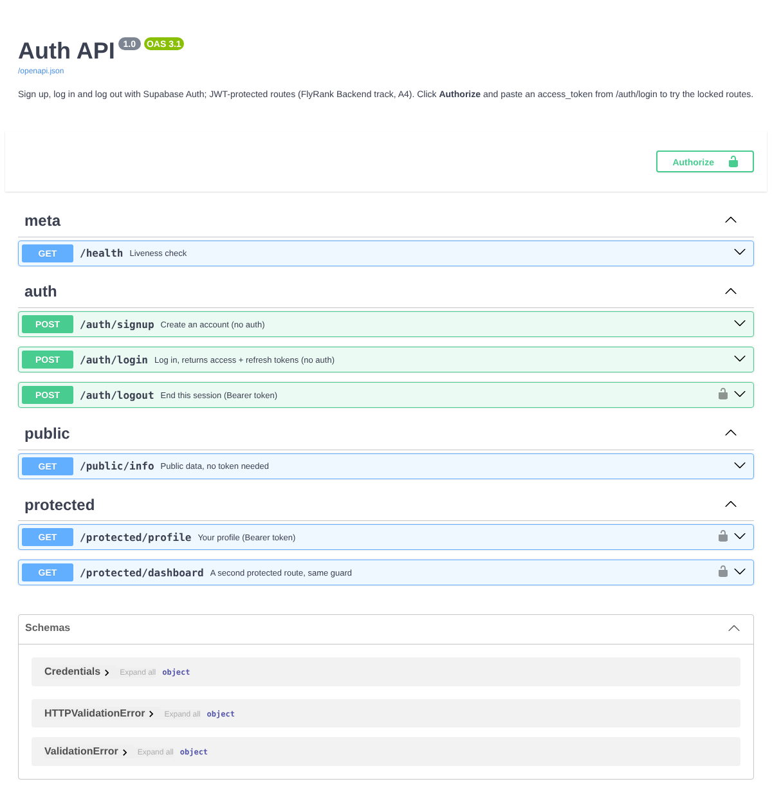

# Auth API (FlyRank Backend track, A4: Login & protect)

A **FastAPI** service with sign up, log in and log out through **Supabase Auth**. It also has JWT-protected routes,
guarded by **one reusable dependency**. Swagger UI shows a padlock on every locked route, and there's an **Authorize**
button for pasting a token.

The rule this follows: **this server never stores a password and never hashes anything.**

- **Supabase** keeps the accounts, hashes the passwords and signs the tokens.
- **This API** forwards credentials to Supabase, then verifies the tokens that come back before opening a protected route.

## Setup (about 5 minutes)

1. Create a free project at [supabase.com](https://supabase.com).
2. In **Project Settings → API**, copy the **Project URL** and the **anon** key. Never use the `service_role` key here.
3. For practice, turn off **Authentication → Sign In / Providers → Email → "Confirm email"** so a new signup can log in immediately.
4. Then:

```powershell
copy .env.example .env           # paste SUPABASE_URL and SUPABASE_KEY into .env
python -m venv .venv; .\.venv\Scripts\Activate.ps1
pip install -r requirements.txt
uvicorn main:app --reload        # logs: "Server running and connected to Supabase (...)"
```

`.env` is git-ignored, and only `.env.example` (placeholders) is committed.

## Endpoints

| Route | Purpose | Auth header | Success | Errors |
|---|---|---|---|---|
| `POST /auth/signup` | Create an account `{"email","password"}` | none | **201** + user | 400 missing field, or Supabase refused (e.g. already registered, weak password) |
| `POST /auth/login` | Get an access token (JWT) + refresh token | none | 200 | 400 missing field · **401** `Invalid login credentials` · **429** after 5 failures |
| `POST /auth/logout` | End this session | `Bearer <token>` | **204** | 401 |
| `GET /protected/profile` | Your id, email, created date | `Bearer <token>` | 200 | 401 |
| `GET /public/info` | Public data | none | 200 | — |
| `GET /protected/dashboard` | Second route, same guard, no new auth code | `Bearer <token>` | 200 | 401 |
| `POST /auth/refresh` *(extra)* | New access token from a refresh token | none | 200 | 401 |
| `GET /protected/admin` *(extra)* | Admins only | `Bearer <token>` | 200 | 401 · **403** |

The 401 responses distinguish two cases:

- `{"error":"Access token required"}`: the header is missing, malformed (`Authorization: abc`, `Basic …`) or empty.
- `{"error":"Invalid or expired token"}`: a token was sent, but Supabase rejected it.

## How the guard works

```python
def current_user(request, _creds = Security(HTTPBearer(auto_error=False)), auth = Depends(get_auth)) -> dict:
    token = bearer_token(request.headers.get("Authorization"))   # strict "Bearer <token>" parsing
    if not token:            raise Unauthorized("Access token required")
    try:                     user = auth.get_user(token)          # network call: Supabase checks signature + expiry
    except InvalidToken:     raise Unauthorized("Invalid or expired token")
    return user

@app.get("/protected/dashboard")
def dashboard(user: dict = Depends(current_user)): ...           # the route body only runs for a verified user
```

**Design decision: a fresh Supabase client for every call** (`persist_session=False`). The SDK's client can remember a
logged-in session. If the whole server shared one client, one user's session could leak into another user's request.

## Try it

```powershell
curl.exe -i -X POST http://localhost:8000/auth/signup -H "Content-Type: application/json" -d '{\"email\":\"test@example.com\",\"password\":\"password123\"}'   # 201
curl.exe -i -X POST http://localhost:8000/auth/login  -H "Content-Type: application/json" -d '{\"email\":\"test@example.com\",\"password\":\"password123\"}'   # 200 + access_token
curl.exe -i http://localhost:8000/public/info                                                    # 200
curl.exe -i http://localhost:8000/protected/profile                                              # 401 Access token required
curl.exe -i http://localhost:8000/protected/profile -H "Authorization: Bearer <ACCESS_TOKEN>"    # 200 + your profile
curl.exe -i http://localhost:8000/protected/profile -H "Authorization: Bearer <TOKEN_WITH_ONE_CHAR_CHANGED>"   # 401 Invalid or expired token
curl.exe -i -X POST http://localhost:8000/auth/logout -H "Authorization: Bearer <ACCESS_TOKEN>" # 204
```

You can do the same in Swagger at http://localhost:8000/docs: click **Authorize**, paste the `access_token`, then
**Try it out** on `/protected/profile`.



## Tests

`pip install -r requirements-dev.txt` then `pytest -q`. All **15 pass**. They cover every checkpoint in the brief:

- 201, 200, 204, 400 and 401 responses
- tampered tokens and malformed headers
- a guard reused on 3 routes
- the 401 vs 403 split
- refresh
- the rate limit
- the padlock in the OpenAPI spec

They run against a **fake identity provider**, so they test this API's logic, not Supabase itself.

The real Supabase wrapper (`auth_provider.py`) was also run against a small mock of Supabase's auth server, which
checked that it sends the right calls and reads the responses correctly (signup, login, wrong password, verify,
tampered token, refresh, logout).

## Extras

- **401 vs 403:** 401 means "I don't know who you are" (no valid token). 403 means "I know who you are, and no":
  `/protected/admin` answers 403 to a logged-in user who isn't an admin. An admin is anyone with `app_metadata.role = "admin"`
  or an email listed in `ADMIN_EMAILS`.
- **Refresh flow:** access tokens are short-lived (1 hour by default), so a stolen one stops working soon. A refresh
  token gets a new one without asking for the password again.
- **Brute-force protection:** after 5 failed logins for the same email within 15 minutes, `/auth/login` returns **429** with
  `Retry-After`. This lives at login because that's the only door where a password can be guessed.
- **Logout and stateless JWTs:** logout revokes the session's *refresh* token at Supabase. The current *access* token is a
  signed, self-contained JWT, so it stays valid until it expires. That's why "instant logout" is genuinely hard, and
  why access tokens are kept short.
- **What's inside a JWT:** the payload (user id, email, role, expiry) is only base64-encoded, not encrypted. Anyone can
  read it at jwt.io. It's the *signature* that makes it trustworthy, so you must never put a secret inside one.

## Limitations

- **The rate limiter is in memory.** It resets on restart and isn't shared between server instances. Production would use Redis.
- **This build wasn't run against a real Supabase project,** because the build environment can't reach supabase.co. It was
  tested with the fake provider and the mock auth server described above. Run the curl list above against your own
  project before submitting.

## How AI was used

Built **with an AI assistant (Claude)**, and stated openly here. The brief asks for Stages 0–6 to be written by hand,
and this version wasn't, so the optional "AI vs me" stage doesn't apply. Verified by running it: the 15 tests and
the wrapper-vs-mock-server run described above.
